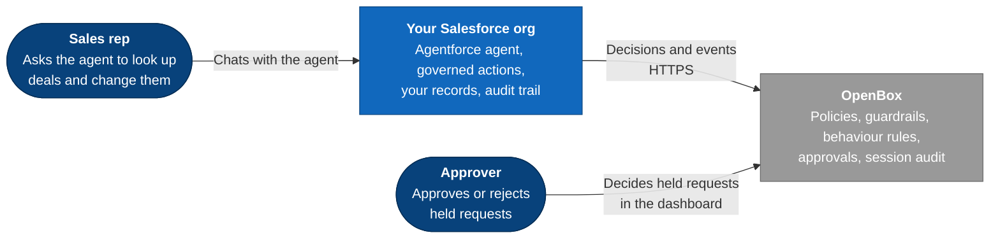
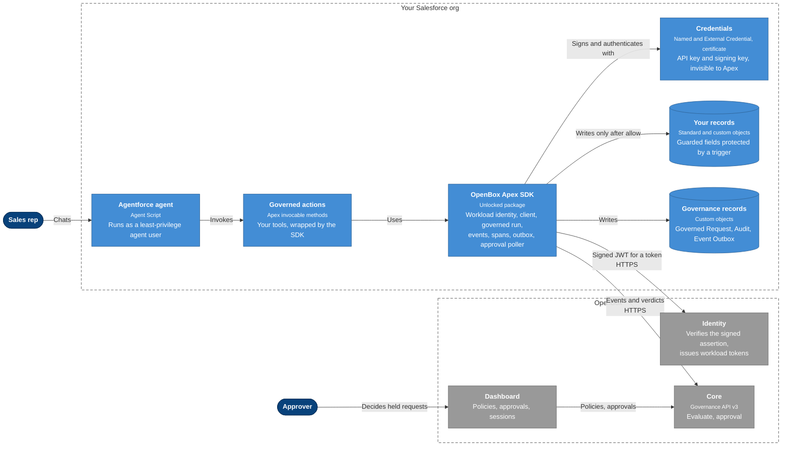
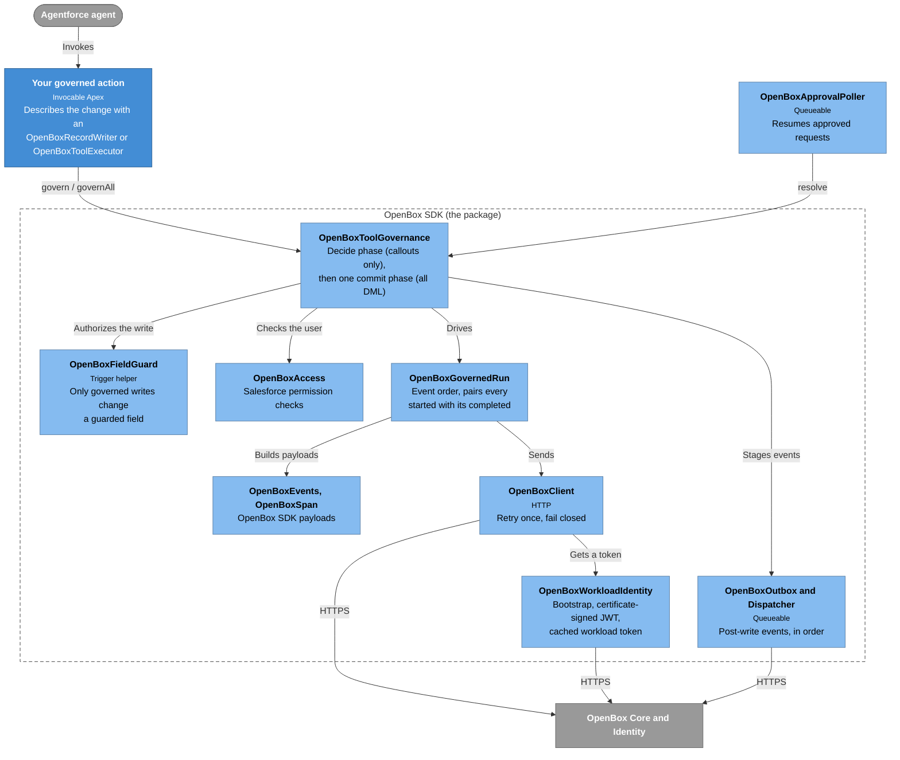
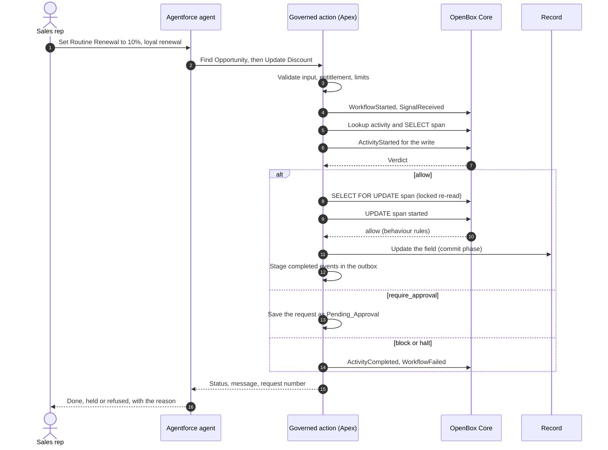
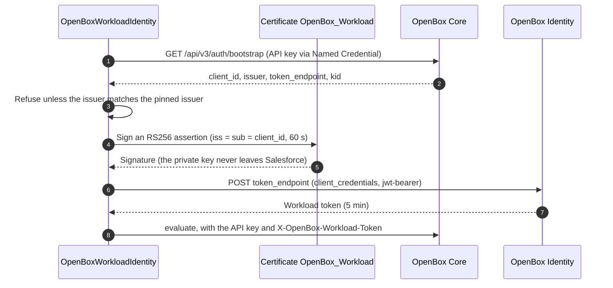
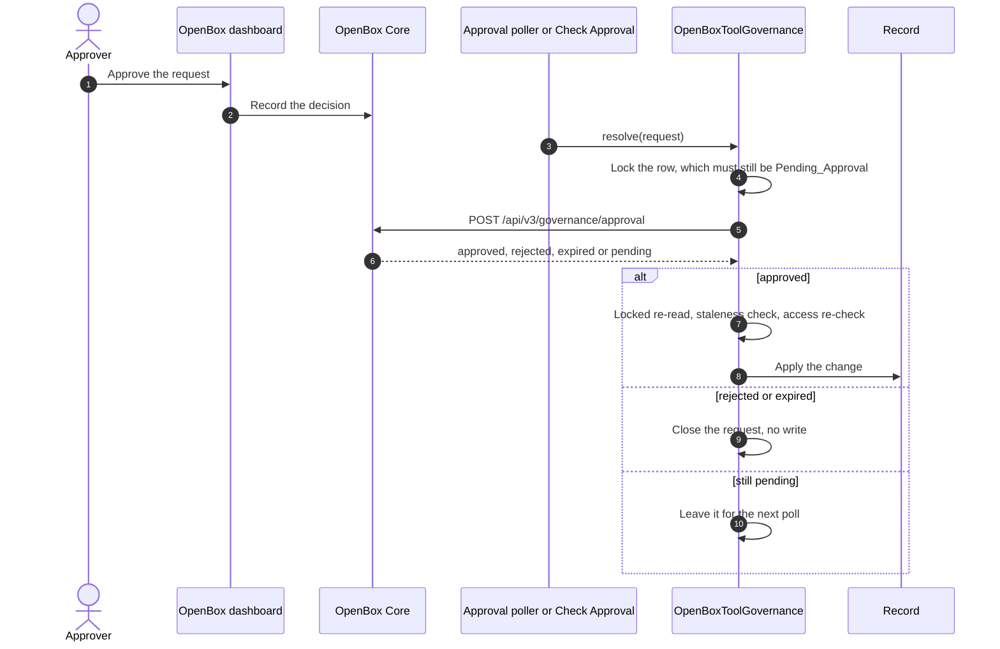
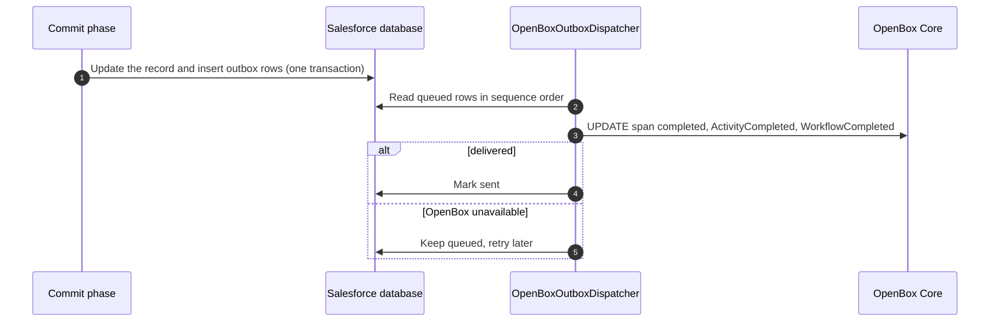

<div align="center">

# OpenBox for Salesforce Agentforce

**Runtime governance for your Agentforce agents. OpenBox decides every message and every action before Salesforce acts on it.**


</div>

---

An Apex SDK, shipped as an unlocked package, that puts your Agentforce agent under OpenBox
governance. It runs inside your own org.

- **Every user message** is checked by OpenBox before the agent reasons about it.
- **Every tool call** is decided before it runs: **`allow`**, **`require_approval`**, **`block`** or
  **`halt`**. Salesforce enforces the answer.
- **Any field can be guarded**, so the agent can change it only through a governed write, never
  directly.
- **Policies live in the OpenBox dashboard.** You change them there, without a deploy.

There is no server to host: Salesforce calls OpenBox over HTTPS, and OpenBox never calls into
Salesforce. If OpenBox cannot answer, nothing is written.

## Contents

- [Quickstart](#quickstart)
- [Building a governed agent](#building-a-governed-agent)
- [Configuration](#configuration)
- [Operating it](#operating-it)
- [Troubleshooting](#troubleshooting)
- [How it works](#how-it-works)
- [Security model](#security-model)
- [Reference agent and contributing](#reference-agent-and-contributing)
- [License](#license)

## Quickstart

You will install the package, connect your org to OpenBox, hook your agent's conversation, and
govern a first tool. Allow about 30 minutes.

**You need:**

- A Salesforce org with Agentforce. On a new Developer Edition or scratch org, turn on **Einstein**
  and **Agentforce** once in Setup. Salesforce requires a person to accept the terms.
- The Salesforce CLI (`npm install -g @salesforce/cli`), logged in to the org: `sf org login web --alias my-org`.
- Node 20 or later, for the setup scripts.
- An OpenBox organisation API key (Organization > API Keys in the OpenBox dashboard) with
  `create:agent`, `read:agent` and `update:agent`.

### 1. Install the package

```bash
sf package install --package 04tgL000000gFKPQA2 --target-org my-org --wait 30 --no-prompt
```

You can also install it from a browser:
[production and Developer Edition](https://login.salesforce.com/packaging/installPackage.apexp?p0=04tgL000000gFKPQA2),
[sandbox](https://test.salesforce.com/packaging/installPackage.apexp?p0=04tgL000000gFKPQA2).
Every version is listed on the [releases page](https://github.com/OpenBox-AI/openbox-agentforce-sdk/releases).

### 2. Connect the org to OpenBox

The setup scripts live in this repository. They need no `npm install`.

```bash
git clone https://github.com/OpenBox-AI/openbox-agentforce-sdk.git
cd openbox-agentforce-sdk
cp .env.example .env
```

In `.env`, set `OPENBOX_ORG_API_KEY` to your key, `OPENBOX_AGENT_NAME` to the name your agent should
have in OpenBox, and `SF_TARGET_ORG` to your org alias (the scripts use it when you don't pass
`--target-org`). Then:

```bash
# A signing certificate generated inside Salesforce; only its public key leaves the org
node scripts/salesforce/workload-certificate.mjs

# Register your agent in OpenBox with that public key
node scripts/openbox/provision.mjs --agent-only

# Store the agent's runtime key in the External Credential OpenBox_Core_Auth
node scripts/salesforce/set-credential.mjs
```

`provision.mjs` writes the agent's runtime key straight to `.env` and never prints it.
`set-credential.mjs` moves it into Salesforce's encrypted credential store, where Apex cannot read it.

### 3. Set up users and the approval poller

```bash
# You, as the administrator
sf org assign permset --name OpenBox_Governance_Admin --target-org my-org

# A dedicated agent user with OpenBox_Governed_Agent; it prints the username and saves it to .env
node scripts/salesforce/create-agent-user.mjs

# The hourly safety net that resumes approved requests
echo "OpenBoxApprovalPollerSchedule.install();" | sf apex run --target-org my-org
```

To use an agent user you already have, assign it `OpenBox_Governed_Agent` instead of creating one.
The agent user also needs access to your own Apex classes (step 5) through a permission set of yours.

### 4. Hook the conversation in Agent Script

In your agent's `.agent` file, add a conversation key variable and the two conversation actions.
Then run them around the reasoning of the start agent and of every subagent:

```yaml
# Excerpt: merge into your agent's .agent file.
config:
    default_agent_user: "<the username create-agent-user.mjs printed>"

variables:
    ob_conversation_key: mutable string = ""
        description: "OpenBox conversation key; passed to every OpenBox action"
    ob_allowed: mutable boolean = True
        description: "Whether OpenBox allowed the agent to act on the latest message"
    ob_message: mutable string = ""
        description: "What to tell the user when OpenBox refused the latest message"

start_agent agent_router:
    actions:
        openbox_govern_message:
            description: "Checks the user's message with OpenBox before the agent acts on it."
            label: "Govern User Message (OpenBox)"
            target: "apex://OpenBox_GovernMessage"
            inputs:
                userInput: string
                    label: "User Message"
                    is_required: False
                conversationKey: string
                    label: "Conversation Key"
                    is_required: False
                subagent: string
                    label: "Subagent"
                    is_required: False
            outputs:
                allowed: boolean
                    label: "Allowed"
                    is_displayable: False
                    filter_from_agent: False
                conversationKey: string
                    label: "Conversation Key"
                    is_displayable: False
                    filter_from_agent: False
                message: string
                    label: "Message"
                    is_displayable: False
                    filter_from_agent: False
        openbox_end_turn:
            description: "Closes the OpenBox run of this turn after the agent has replied."
            label: "End Turn (OpenBox)"
            target: "apex://OpenBox_EndTurn"
            inputs:
                conversationKey: string
                    label: "Conversation Key"
                    is_required: False
            outputs:
                closed: boolean
                    label: "Closed"
                    is_displayable: False
                    filter_from_agent: False

    before_reasoning:
        run @actions.openbox_govern_message
            with userInput = @system_variables.user_input
            with conversationKey = @variables.ob_conversation_key
            with subagent = ""
            set @variables.ob_conversation_key = @outputs.conversationKey
            set @variables.ob_allowed = @outputs.allowed
            set @variables.ob_message = @outputs.message
        if @variables.ob_allowed == False:
            transition to @subagent.governance_refused

    after_reasoning:
        run @actions.openbox_end_turn
            with conversationKey = @variables.ob_conversation_key
```

Add the same `before_reasoning` and `after_reasoning` blocks, and the same two actions, to every
subagent. Then add the subagent the router sends refused messages to:

```yaml
subagent governance_refused:
    label: "Governance Refused"
    description: "Used only when OpenBox governance refused the user's latest message."
    actions:
        openbox_end_turn:
            # the same declaration as above
    reasoning:
        instructions: ->
            | OpenBox governance refused the user's latest message, so you must not act on it.
              Reply with exactly this message and nothing else: {!@variables.ob_message}
    after_reasoning:
        run @actions.openbox_end_turn
            with conversationKey = @variables.ob_conversation_key
```

The [reference agent](reference-agent/main/default/aiAuthoringBundles/OpenBox_Sales_Agent/OpenBox_Sales_Agent.agent)
is a complete, working file to copy from, subagents included.

Because the hook runs deterministically in `before_reasoning` with the raw message, the model never
acts on a message OpenBox has not seen.

### 5. Govern your first tool

Wrap the tool's work in an `OpenBoxToolExecutor`, and route the call through
`OpenBoxToolGovernance`. OpenBox decides before `execute` runs.

```apex
public with sharing class FindAccount {
    public class Request {
        @InvocableVariable(label='Account Name' required=true)
        public String name;
        @InvocableVariable(label='Conversation Key')
        public String conversationKey;
    }

    public class Result {
        @InvocableVariable(label='Message')
        public String message;
        @InvocableVariable(label='Account ID')
        public Id accountId;
    }

    /** The tool's work. It runs only after OpenBox allows the call. */
    public class Finder implements OpenBoxToolExecutor {
        public Map<String, Object> execute(OpenBoxToolContext context, Map<String, Object> input) {
            String term = String.valueOf(input.get('name')).replace('\\', '\\\\').replace('%', '\\%').replace('_', '\\_');
            String pattern = '%' + term + '%';
            List<Account> found = [SELECT Id, Name FROM Account WHERE Name LIKE :pattern WITH USER_MODE LIMIT 1];
            return new Map<String, Object>{
                'account_id' => found.isEmpty() ? null : found[0].Id,
                'name' => found.isEmpty() ? null : found[0].Name
            };
        }
    }

    @InvocableMethod(label='Find Account' description='Finds an Account by name and returns its record id.')
    public static List<Result> find(List<Request> requests) {
        List<OpenBoxToolGovernance.ToolCall> calls = new List<OpenBoxToolGovernance.ToolCall>();
        for (Request request : requests) {
            OpenBoxToolGovernance.ToolCall call = new OpenBoxToolGovernance.ToolCall();
            call.sessionKey = request.conversationKey;                 // joins the conversation's OpenBox session
            call.toolName = 'find_account';                            // the activity_type your policies match on
            call.input = new Map<String, Object>{ 'name' => request.name };
            call.targetType = OpenBoxToolGovernance.TARGET_APEX_EXECUTOR;
            call.targetName = Finder.class.getName();
            call.readOnly = true;
            calls.add(call);
        }
        List<Result> results = new List<Result>();
        for (OpenBoxToolGovernance.Result outcome : new OpenBoxToolGovernance().governAll(calls)) {
            Result result = new Result();
            if (outcome.executed && outcome.output != null && outcome.output.get('account_id') != null) {
                result.accountId = Id.valueOf(String.valueOf(outcome.output.get('account_id')));
                result.message = 'Found ' + outcome.output.get('name') + '.';
            } else {
                result.message = outcome.message;                      // OpenBox's refusal, or "not found"
            }
            results.add(result);
        }
        return results;
    }
}
```

`governAll` decides every call before any of them runs, so a batch never makes a callout after DML.

Declare the action in Agent Script, and pass it the conversation key. An `Id` (or `Integer`) input or
output must declare its Lightning type:

```yaml
        find_account:
            description: "Finds an Account by name."
            label: "Find Account"
            target: "apex://FindAccount"
            inputs:
                name: string
                    label: "Account Name"
                    is_required: True
                conversationKey: string
                    label: "Conversation Key"
                    is_required: False
            outputs:
                message: string
                    label: "Message"
                    is_displayable: False
                    filter_from_agent: False
                accountId: object
                    complex_data_type_name: "lightning__recordIdType"
                    label: "Account ID"
                    is_displayable: False
                    filter_from_agent: False
```

```yaml
    reasoning:
        actions:
            find_account: @actions.find_account
                with name = ...
                with conversationKey = @variables.ob_conversation_key
```

### 6. Publish and try it

From your own Salesforce DX project, the one that holds `FindAccount` and your agent's bundle:

```bash
sf project deploy start --source-dir force-app --target-org my-org
sf agent publish authoring-bundle --api-name My_Agent --target-org my-org
sf agent activate --api-name My_Agent --target-org my-org
sf agent preview --api-name My_Agent --target-org my-org
```

Ask the agent to find an Account. Then, in the OpenBox dashboard, open your agent:

- **Sessions** shows the conversation: the user message, the `find_account` call and OpenBox's
  verdict for each.
- **Add a policy rule** that blocks `activity_type` `find_account`, and ask again. The agent now
  replies with OpenBox's refusal, and the lookup never runs.

That is the whole loop. Everything else in this README builds on it.

## Building a governed agent

### Apex tools

Implement `OpenBoxToolExecutor` and call `OpenBoxToolGovernance.govern(...)`, or `governAll(...)` for
several calls, as in the [Quickstart](#5-govern-your-first-tool).

- **`toolName`** is the `activity_type` OpenBox policies match on. **`input`** becomes the
  `activity_input` they read.
- **`readOnly = true`** marks a lookup. Output guardrails apply to its result before the agent sees it.
- **An executor resumed after approval** runs in a background job, as a different user than the one
  who asked. It must check access for `context.requestedById` itself, and it needs a public
  no-argument constructor so it can be rebuilt by class name.
- **Throwing from `execute`** reports the call as failed, and rolls back whatever it changed.

### Record writes and guarded fields

To put a field behind OpenBox, extend `OpenBoxRecordWriter` and describe the change. The SDK does the
lookup, the decision, the locked re-read, the staleness and access checks, and the write.

```apex
public with sharing class AccountCreditLimitWriter extends OpenBoxRecordWriter {
    public override SObjectType objectType() { return Account.SObjectType; }
    public override Id recordId(Map<String, Object> input) { return (Id) input.get('account_id'); }
    public override Map<String, Object> changes(Map<String, Object> input) {
        return new Map<String, Object>{ 'Credit_Limit__c' => Decimal.valueOf(String.valueOf(input.get('limit'))) };
    }
    public override List<String> snapshotFields() { return new List<String>{ 'Name', 'Rating', 'Credit_Limit__c' }; }
}
```

```apex
OpenBoxToolGovernance.ToolCall call = new OpenBoxToolGovernance.ToolCall();
call.toolName = 'AccountCreditLimitUpdate';            // the activity_type policies match on
call.writer = AccountCreditLimitWriter.class;
call.input = new Map<String, Object>{ 'account_id' => accountId, 'limit' => 50000 };
call.sessionKey = conversationKey;                     // blank: the write is an OpenBox run of its own
OpenBoxToolGovernance.Result result = new OpenBoxToolGovernance().govern(call);
```

Then guard the field, so nothing else can change it:

```apex
trigger AccountCreditLimitGuard on Account(before insert, before update) {
    OpenBoxFieldGuard.enforce(Trigger.new, Trigger.oldMap, new Set<SObjectField>{ Account.Credit_Limit__c });
}
```

Give the agent user read access to the field, not edit access. Add the field to the page layout as
usual: the guard does not hide it, it only refuses changes that do not come through a governed write.

What every governed write gets, with no code of your own:

| Step | What happens |
|---|---|
| Before OpenBox | `validate()`, the requesting user's entitlement (`OpenBox_Governed_Record_Write`, or the writer's own custom permission) and capacity checks |
| Lookup | A `<Object>Lookup` activity; the record is read `WITH USER_MODE` under a SELECT span, and output guardrails redact the snapshot before `summary()` reaches the agent |
| Decision | The write's `ActivityStarted` carries `facts()`, plus `requested_change`, `justification` and `actor_id` |
| Before the write | Locked re-read (`SELECT ... FOR UPDATE` span), staleness against what was read, `refusal()`, object, field and record access for the requesting user, then an UPDATE span for behaviour rules |
| Write | One system-mode update in the commit phase, authorized past the field guard for that DML only; the outcome reaches OpenBox through the outbox |
| Approval | The request waits as `Pending_Approval` and is applied by the poller or `Check Approval`, after the same checks |

Several calls in one transaction (`governAll`) are all decided before any of them writes.

### Flows, standard actions and invocable Apex

You don't need to write Apex for these. Register each one as a record of the custom metadata type
`OpenBox_Governed_Tool__mdt`:

| Field | Value |
|---|---|
| `Tool_Name__c` | The name the agent uses, and the `activity_type` policies match on |
| `Target_Type__c` | `flow`, `standard` (a standard action), `apex` (invocable Apex), `apex_executor` or `record_writer` |
| `Target_Name__c` | The flow's API name, the action's name, or the class name |
| `Read_Only__c` | `true` for lookups |
| `Active__c` | Only active tools can run |
| `Description__c` | What the tool does and its inputs, for the agent |

Then give the agent the action `Run Governed Tool (OpenBox)` (`apex://OpenBox_GovernedAction`), with
`toolName`, `inputJson` and `conversationKey`. The reference agent registers a flow this way:
[`OpenBox_Governed_Tool.Log_Opportunity_Note`](reference-agent/main/default/customMetadata/OpenBox_Governed_Tool.Log_Opportunity_Note.md-meta.xml).

### Approvals

When OpenBox answers `require_approval`, the call waits as a `Pending_Approval` governed request, and
the agent gets its request number. An approver decides it in the OpenBox dashboard.

- **Apex tools and record writes** are applied by the background poller once approved, after the same
  checks as a direct call.
- **Flows and standard actions** run when the agent checks on the request, as the agent's own user,
  never as the background job's user.
- **`Check Approval (OpenBox Governed)`** (`apex://OpenBox_CheckApproval`, input `requestReference`)
  lets the agent check on a request on the user's behalf. It resolves through the same path as the
  poller.

### The conversation, end to end

Each user message is one OpenBox run, closed when Salesforce replies. All runs of a conversation share
its `workflow_id` and `session_id`.

| When | Event | Decides? |
|---|---|---|
| A user message arrives | `WorkflowStarted` (goal = the message), then `SignalReceived` `user_prompt` | **Yes**: block or approval refuses the message, halt ends the conversation |
| The agent moves to a subagent | `SignalReceived` `subagent_selected` | No |
| The agent calls any tool | `ActivityStarted`, `activity_type` = tool name, `activity_input` = its arguments | **Yes**: the tool runs only on allow; approval holds it |
| The tool finishes | `ActivityCompleted` with the result or error | Read-only tools: output guardrails apply before the agent sees the result |
| Salesforce replies | `WorkflowCompleted` (status `failed` when OpenBox refused the message), queued so the reply is not delayed | No |

A turn that leaves a call waiting for approval stays open until that call is approved and run,
rejected, or expires. Turns whose reply never arrives are closed by an hourly idle sweep.

## Configuration

### Settings

The custom metadata record `OpenBox_Settings__mdt.Default`:

| Field | Default | Purpose |
|---|---|---|
| `Named_Credential__c` | `OpenBox_Core` | The Named Credential for OpenBox Core |
| `Agent_Name__c` | `Agentforce Sales Agent` | The workflow name your sessions show in OpenBox |
| `Workflow_Type__c` | `AgentforceGovernedAction` | Workflow type reported to OpenBox |
| `Task_Queue__c` | `salesforce-agentforce` | Task queue reported to OpenBox |
| `Callout_Timeout_Ms__c` | `10000` | How long Apex waits for OpenBox before failing closed |
| `Approval_Poll_Interval_Minutes__c` | `1` | How often the poller checks waiting requests |
| `Max_Requests_Per_Transaction__c` | `5` | Governed calls allowed in one transaction |
| `Outbox_Max_Attempts__c` | `5` | Delivery attempts for post-write events |
| `Identity_Issuer__c` | `https://identity.openbox.ai/realms/openbox` | The one identity issuer Apex trusts |
| `Workload_Certificate__c` | `OpenBox_Workload` | The certificate that signs workload assertions |

### Permission sets and custom permissions

| Name | Give it to |
|---|---|
| `OpenBox_Governed_Agent` | The agent user: it may invoke the governed actions |
| `OpenBox_Governance_Admin` | Administrators: governed requests, audit and settings |
| `OpenBox_Governed_Record_Write` (custom permission) | Users on whose behalf the agent may request a governed write |
| `OpenBox_Guarded_Field_Direct_Edit` (custom permission) | People allowed to edit a guarded field directly |

Installing the package grants its custom permissions to the System Administrator profile, so
administrators can edit a guarded field directly. To hold them to governed writes too, remove
`OpenBox_Guarded_Field_Direct_Edit` from that profile and grant it only through a permission set.

### The OpenBox API key

The scripts authenticate with your organisation API key. Keys are created with an explicit set of
permissions:

| Script | Needs |
|---|---|
| `provision.mjs --agent-only` | `create:agent`, `read:agent`, `update:agent` |
| `provision.mjs` (the reference agent, with its controls) | The above, plus `read:` and `update:` on `agent_policy`, `agent_guardrail` and `agent_behavior_rule`, and `manage:governance_control` to create shipped controls missing from your library |
| `approvals.mjs` | `manage:agent_session` |
| `inspect-session.mjs` | `read:agent_session`, `read:agent_log` |

### Another OpenBox environment

The package points at OpenBox production. To use another environment, set `OPENBOX_PLATFORM_API_URL`
and `OPENBOX_CORE_URL` in `.env`, and after `provision.mjs` run:

```bash
node scripts/salesforce/configure-endpoints.mjs
```

It asks that Core for its identity issuer, and repoints the `OpenBox_Core` Named Credential, the
`OpenBox_Identity` Remote Site and `Identity_Issuer__c`, in the org only.

### Several orgs

Keep each org's agent and key in its own env file, and use the same `OPENBOX_ENV_FILE` for every
script:

```bash
OPENBOX_ENV_FILE=.env.sandbox node scripts/openbox/provision.mjs --agent-only
OPENBOX_ENV_FILE=.env.sandbox node scripts/salesforce/set-credential.mjs --target-org my-sandbox
```

## Operating it

| Task | How |
|---|---|
| See every governed call | List view or report on `OpenBox_Governed_Request__c` |
| Audit trail | `OpenBox_Governance_Audit__c`, linked to each request |
| Conversations | `OpenBox_Agent_Session__c`, one per conversation |
| Approve or reject | OpenBox dashboard, or `node scripts/openbox/approvals.mjs approve <request-id>` |
| See what OpenBox stored | OpenBox dashboard > the agent > Sessions, or `node scripts/openbox/inspect-session.mjs <request-id>` |
| Undelivered events | `OpenBox_Event_Outbox__c` with `Status__c` `Queued` or `Failed` |
| Change policy | OpenBox dashboard > the agent; the next call follows it |

## Troubleshooting

| Symptom | Cause and fix |
|---|---|
| Every call ends `Failed` with *OpenBox governance unavailable: OpenBox unreachable: Read timed out* | OpenBox did not answer within `Callout_Timeout_Ms__c`, so the SDK failed closed and wrote nothing. Check OpenBox's status, and that the guardrails attached to your agent are reachable. |
| *OpenBox workload bootstrap names issuer …, but only … is trusted* | The org trusts a different OpenBox environment from the one your agent belongs to. Run `configure-endpoints.mjs` with that environment in `.env`. |
| `provision.mjs` fails with *Required permissions: …* (HTTP 403) | Your API key lacks that permission. See [The OpenBox API key](#the-openbox-api-key). |
| Publishing the agent fails on an `Id` or `Integer` input or output | Declare its type: `complex_data_type_name: "lightning__recordIdType"` or `"lightning__integerType"`. |
| Agentforce settings fail to deploy on a new org (*Legal Terms acceptance…*) | Turn on Einstein and Agentforce once in Setup, and accept the terms. |
| An approved request is not applied | Check that the poller schedule is installed (`OpenBoxApprovalPollerSchedule.install()`). The agent can also apply it with `Check Approval`. |
| An administrator can edit a guarded field directly | By design. See [Permission sets and custom permissions](#permission-sets-and-custom-permissions). |
| Your action fails for the agent with an access error | Grant the agent user your Apex classes, and read access to the fields they use, through a permission set of yours. |

## How it works

### The big picture

Who uses the system, and what talks to what.



### Inside your Salesforce org

The parts that run in the org, and the OpenBox services they reach.



<sub>Blue: runs in your org. Grey: OpenBox. Dashed: boundary.</sub>

### Inside the SDK

The Apex classes behind a governed call.



<sub>Light blue: SDK classes. Blue: your code. Grey: outside the org.</sub>


### A governed write, end to end

Shown with the reference agent's discount change; your own writes follow the same path.



### Workload identity

Salesforce proves who it is without a shared secret leaving the org.



### Approval



### Events after the write

Apex cannot make a callout after DML in the same transaction, so events that report a completed
write wait in an outbox and are delivered in order.



### Wire format

A governed write produces this sequence within its run. Events and spans follow the OpenBox SDK wire
format: the lifecycle shapes of the LangGraph SDK and the flat `SpanData` spans of the base SDK.

```
WorkflowStarted                       goal = the user's request
SignalReceived      user_prompt
ActivityStarted     <Object>Lookup
  span SELECT <Object>                started → completed
ActivityCompleted   <Object>Lookup    output guardrails may redact what the agent sees
ActivityStarted     <tool name>       ◄ policy rules and input guardrails decide
  span SELECT <Object> (FOR UPDATE)   started → completed    locked re-read
  span UPDATE <Object>                started ◄ behaviour rules decide → write → completed
ActivityCompleted   <tool name>
WorkflowCompleted | WorkflowFailed
```

- Every `ActivityStarted` is closed by exactly one `ActivityCompleted` with the same `activity_id`, on
  success, failure or refusal. A span refused at `started` is closed as an error. After a `halt`,
  OpenBox closes the session and accepts nothing more.
- Event timestamps strictly increase within a transaction, so stored order matches send order.

## Security model

- **The governed write is the only path.** The agent user holds a guarded field read-only, and a
  trigger calling `OpenBoxFieldGuard` rejects any change that a governed write has not authorized for
  that record and field. Agent instructions are not relied on.
- **Both systems must agree.** An OpenBox `allow` is followed by Salesforce checks for the requesting
  user: entitlement, object edit, field read and record edit access.
- **Fails closed.** Unreachable OpenBox, timeouts, non-2xx answers, malformed bodies, unknown verdicts
  and identity failures all mean no write. Gateway errors are retried once with the same idempotency
  key.
- **Secrets.** The API key lives in the External Credential, encrypted and injected at callout time.
  The signing key never leaves the Salesforce certificate store. Neither is logged or kept in source.
- **Workload identity.** Salesforce proves who it is with a certificate-signed assertion, exchanged for
  a short-lived workload token. Apex trusts only the issuer pinned in `Identity_Issuer__c`.
- **Replay safety.** A request executes only from `Pending_Approval`, under `FOR UPDATE`, and leaves
  that status in the same transaction: at most one committed change per request.
- **Staleness.** If the record changed while the request waited, it is refused as `Stale`.

## Reference agent and contributing

### The reference agent

[`reference-agent/`](reference-agent) is a complete, working example built only on the SDK: an
Agentforce sales agent that looks up Opportunities and changes their discount, with the discount field
guarded. It is deployed as source, not packaged.

| Piece | What it shows |
|---|---|
| `OpportunityDiscountWriter` | A record writer: the field it changes and the facts policies decide on |
| `OpportunityDiscountGuard` | The one-line field guard on `Opportunity.Discount__c` |
| `OpenBox_FindOpportunity` | A read-only Apex tool governed through `OpenBoxToolExecutor` |
| `OpenBox_Log_Opportunity_Note` | A flow registered as a governed tool |
| `OpenBox_Sales_Agent` | The Agent Script, with the conversation hooks wired in |

`provision.mjs` (without `--agent-only`) gives its OpenBox agent a starting set of controls. After that
they belong to the OpenBox dashboard and are never overwritten (`--reset-policy` restores the
defaults). The highest matching priority wins; a request matching no rule is allowed.

| Priority | Rule, on `ActivityStarted` of `OpportunityDiscountUpdate` | Decision |
|---:|---|---|
| 100 | `is_closed = true` | 🚫 Block |
| 90 | `proposed_discount ≥ 90` | ⛔ Halt |
| 80 | `proposed_discount > 40` | 🚫 Block |
| 70 | `proposed_discount > 15` | ⏳ Require approval |
| — | no rule matches | ✅ Allow |

Also provisioned: **guardrails** (personal-data redaction in the justification and the record
snapshot, and a manipulation-phrase tripwire), **behaviour rules** (a locked re-read before the write,
sign-off for late-stage deals) and **goal alignment**.

To run it in an org, from a clone of this repository:

```bash
node scripts/salesforce/workload-certificate.mjs --target-org my-org
node scripts/openbox/provision.mjs
node scripts/salesforce/deploy.mjs --target-org my-org          # force-app + reference-agent, with tests
node scripts/salesforce/setup-org.mjs --target-org my-org --skip-deploy
node scripts/salesforce/create-agent-user.mjs --target-org my-org
node scripts/salesforce/publish-agent.mjs --target-org my-org
```

`deploy.mjs` deploys the SDK from source as well. To use the installed package instead, deploy only
`reference-agent` (`sf project deploy start --source-dir reference-agent`).

### Testing

| Suite | Command | Covers |
|---|---|---|
| Apex | Run by `deploy.mjs` and by every package version build | Against a scripted OpenBox: workload identity, event and span pairing, the trust boundary, failing closed, approvals, replay, staleness, the field guard |
| End to end | `node scripts/e2e/run-live.mjs --target-org my-org` | The reference agent against the OpenBox environment in `.env`, including a real Agentforce conversation. Each scenario checks the Salesforce outcome, the verdicts OpenBox recorded and the pairing of the stored session. The report is written to `out/e2e-report.json` |

### Building the package

`force-app` is the unlocked package `OpenBoxGovernance`. A version build runs the Apex tests and the
code-coverage check:

```bash
sf package version create --package OpenBoxGovernance --installation-key-bypass --code-coverage \
  --wait 60 --target-dev-hub <dev hub>
```

### Repository layout

```
.
├── force-app/                     # the package (OpenBoxGovernance, unlocked)
│   └── main/default/
│       ├── classes/               # the Apex SDK, its actions and tests
│       ├── objects/               # Governed Request, Agent Session, Audit, Event Outbox, Settings (mdt)
│       ├── namedCredentials/      # OpenBox_Core
│       ├── externalCredentials/   # OpenBox_Core_Auth (API key)
│       ├── remoteSiteSettings/    # OpenBox_Identity
│       ├── permissionsets/        # OpenBox_Governed_Agent, OpenBox_Governance_Admin
│       └── customPermissions/     # Governed_Record_Write, Guarded_Field_Direct_Edit
├── reference-agent/               # the worked example; deployed, not packaged
├── config/                        # scratch org definition for a package test org
├── scripts/
│   ├── openbox/                   # register the agent and its controls, inspect sessions, approvals
│   ├── salesforce/                # certificate, credential, endpoints, agent user, deploy, publish
│   └── e2e/run-live.mjs           # end-to-end suite against a real org and OpenBox
└── LICENSE                        # MIT
```

## License

[MIT](LICENSE)
