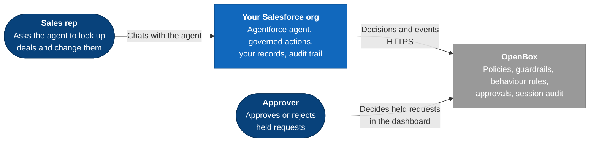
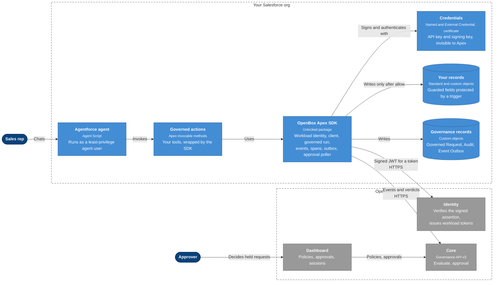
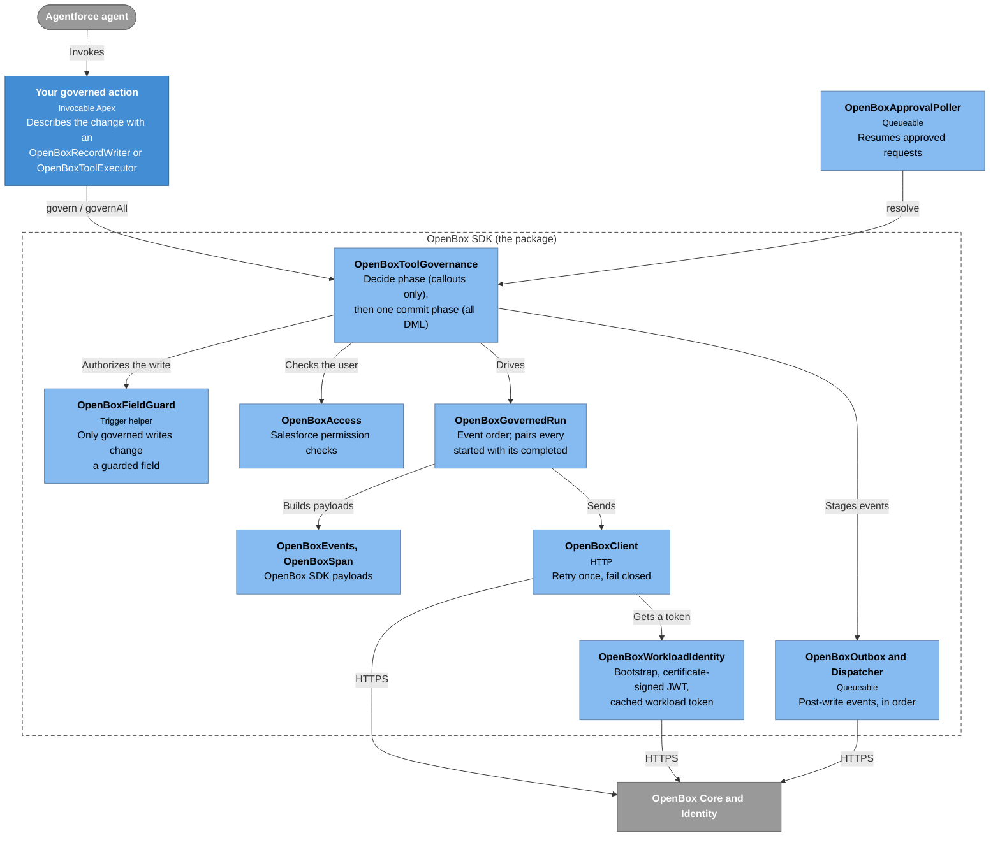
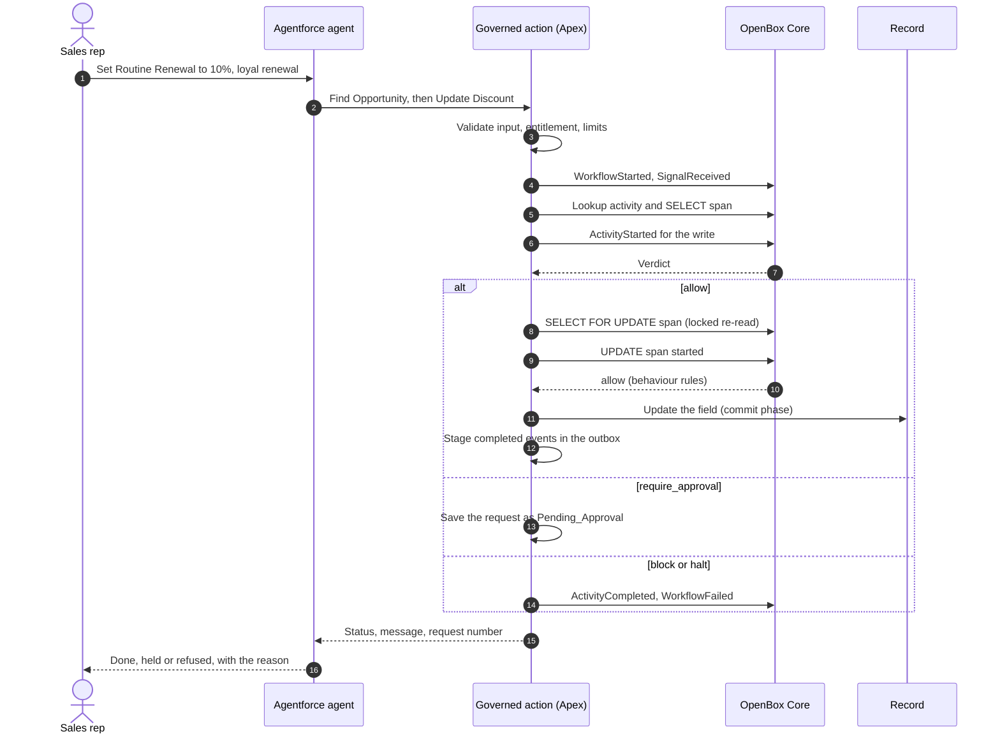
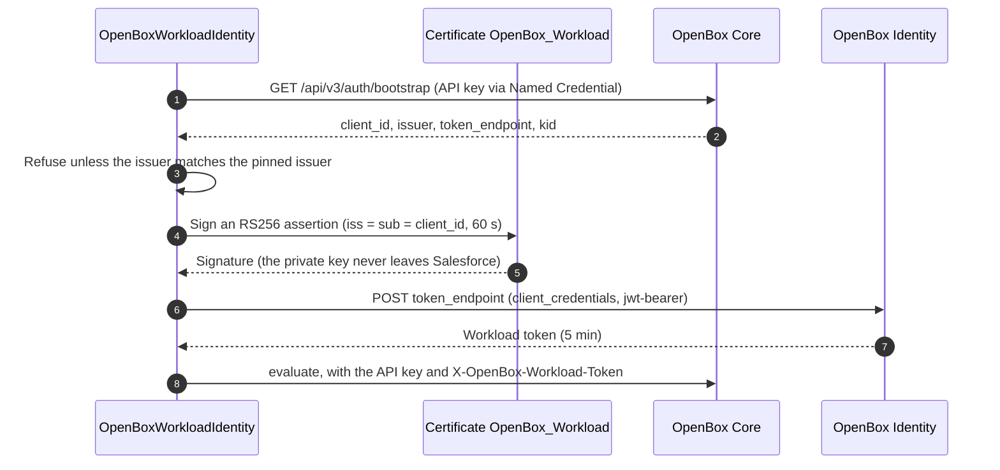
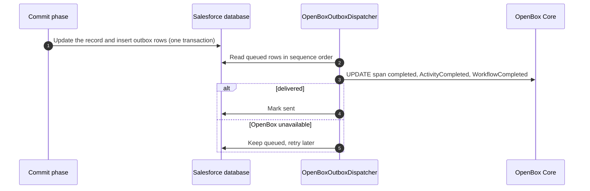

<div align="center">

# OpenBox for Salesforce Agentforce

**Runtime governance for Agentforce agents. OpenBox decides every risky action before Salesforce applies it.**


</div>

---

The OpenBox SDK for Salesforce. It is written in Apex and runs inside your own Salesforce org.

Every message an Agentforce agent receives and every tool it calls is put to OpenBox first. OpenBox
answers **`allow`**, **`require_approval`**, **`block`** or **`halt`**, and Salesforce enforces that
answer before any record changes. Any record field can be put behind OpenBox, so that an agent can
change it only through a governed write. Both sides keep a correlated audit of what happened.

> [!NOTE]
> There is no server to host. Salesforce calls OpenBox directly over HTTPS, and OpenBox never calls
> into Salesforce.

## Contents

- [Highlights](#highlights)
- [Architecture](#architecture)
- [How it works](#how-it-works)
- [Governing the whole conversation](#governing-the-whole-conversation)
- [Governing your own record writes](#governing-your-own-record-writes)
- [Wire format](#wire-format)
- [Security model](#security-model)
- [The reference agent](#the-reference-agent)
- [Installation](#installation)
- [Running it from source](#running-it-from-source)
- [Operating it](#operating-it)
- [Testing](#testing)
- [Repository layout](#repository-layout)
- [Limitations](#limitations)

## Highlights

| | |
|---|---|
| **One path to the data** | Any field can be guarded: a one-line trigger rejects every change that does not come through an OpenBox governed write |
| **Four verdicts, enforced** | Allow, require approval, block and halt are enforced in Apex before any write |
| **Fails closed** | No answer, a timeout, a malformed body or an identity failure means no write |
| **No secrets in code** | The API key sits in a Named Credential that Apex cannot read; identity is proven by a certificate whose private key never leaves Salesforce |
| **Same telemetry as the other OpenBox SDKs** | Events and spans in the shape the OpenBox Python and TypeScript SDKs send, every *started* paired with its *completed* |
| **Policy without deploys** | Rules, guardrails and behaviour rules are edited in the OpenBox dashboard; the next request follows them |
| **Installable** | Ships as an unlocked Salesforce package and is tested from a clean install |

## Architecture

### The big picture

Who uses the system, and what talks to what.



### Inside your Salesforce org

The parts that run in the org, and the OpenBox services they reach.



<sub>Blue: runs in your org. Grey: OpenBox. Dashed: boundary.</sub>

### Inside the SDK

The Apex classes behind a governed call.



<sub>Light blue: SDK classes. Blue: your code. Grey: outside the org.</sub>

## How it works

### A governed write, end to end

Shown with the reference agent's discount change; your own writes follow the same path.



### Workload identity

Salesforce proves who it is without a shared secret leaving the org.



### Approval

```mermaid
sequenceDiagram
  autonumber
  actor Approver
  participant Dash as OpenBox dashboard
  participant Core as OpenBox Core
  participant Poller as Approval poller or Check Approval
  participant Apex as OpenBoxToolGovernance
  participant Rec as Record

  Approver->>Dash: Approve the request
  Dash->>Core: Record the decision
  Poller->>Apex: resolve(request)
  Apex->>Apex: Lock the row; it must still be Pending_Approval
  Apex->>Core: POST /api/v3/governance/approval
  Core-->>Apex: approved, rejected, expired or pending

  alt approved
    Apex->>Apex: Locked re-read, staleness check, access re-check
    Apex->>Rec: Apply the change
  else rejected or expired
    Apex->>Apex: Close the request, no write
  else still pending
    Apex->>Apex: Leave it for the next poll
  end
```

### Events after the write

Apex cannot make a callout after DML in the same transaction, so events that report a completed
write wait in an outbox and are delivered in order.



## Governing the whole conversation

Like the other OpenBox SDKs, the agent reports **every intent** to OpenBox, not only writes. Each user
message is one OpenBox run, closed when Salesforce replies; all runs of a conversation share its
`workflow_id` and `session_id`.

| When | Event | Decides? |
|---|---|---|
| A user message arrives | `WorkflowStarted` (goal = the message), then `SignalReceived` `user_prompt` | **Yes**: block or approval refuses the message, halt ends the conversation |
| The agent moves to a subagent | `SignalReceived` `subagent_selected` | No |
| The agent calls any tool | `ActivityStarted`, `activity_type` = tool name, `activity_input` = its arguments | **Yes**: the tool runs only on allow; approval holds it |
| The tool finishes | `ActivityCompleted` with the result or error | Read-only tools: output guardrails apply before the agent sees the result |
| Salesforce replies | `WorkflowCompleted` (status `failed` when OpenBox refused the message), queued so the reply is not delayed | No |

A turn that leaves a call waiting for approval is not closed by the reply; it is closed when that call
is approved and run, rejected or expires. Turns whose reply never arrives are closed by an hourly idle
sweep.

**How it hooks in.** Every subagent of the agent script, and the router, runs `Govern User Message`
deterministically in `before_reasoning` with the raw message (`@system_variables.user_input`), so the
model never acts on a message OpenBox has not seen. `End Turn` runs in `after_reasoning` and closes the
run once the reply is ready. The first call mints a conversation key; the agent keeps it in a variable
and passes it to every governed action, which then join the same session.

**Governing your own tools.**

- *Record writes:* extend `OpenBoxRecordWriter` (see [the next section](#governing-your-own-record-writes)).
- *Apex:* implement `OpenBoxToolExecutor` and call `OpenBoxToolGovernance.govern(...)` with the
  conversation key, the tool name and its arguments. OpenBox decides before `execute` runs.
- *Flows, standard actions and invocable Apex:* register them in `OpenBox_Governed_Tool__mdt` and give
  the agent `Run Governed Tool (OpenBox)`. Only registered, active tools can run. A record writer can
  be registered the same way (target type `record_writer`).
- *Approvals:* `Check Approval (OpenBox Governed)` resolves any held call through the same path the
  background poller uses. An approved Apex tool or record write runs from the poller; an approved flow
  or action runs when the agent checks on it, as the agent's own user, never as the background job's
  user.

## Governing your own record writes

The package carries no business logic. To put a field behind OpenBox, extend `OpenBoxRecordWriter` and
say what is read, what changes and which facts OpenBox policies decide on. The SDK does the rest.

```apex
public with sharing class AccountCreditLimitWriter extends OpenBoxRecordWriter {
    public override SObjectType objectType() { return Account.SObjectType; }
    public override Id recordId(Map<String, Object> input) { return (Id) input.get('account_id'); }
    public override Map<String, Object> changes(Map<String, Object> input) {
        return new Map<String, Object>{ 'Credit_Limit__c' => Decimal.valueOf(String.valueOf(input.get('limit'))) };
    }
    public override List<String> snapshotFields() { return new List<String>{ 'Name', 'Rating', 'Credit_Limit__c' }; }
}
```

```apex
OpenBoxToolGovernance.ToolCall call = new OpenBoxToolGovernance.ToolCall();
call.toolName = 'AccountCreditLimitUpdate';            // the activity_type policies match on
call.writer = AccountCreditLimitWriter.class;
call.input = new Map<String, Object>{ 'account_id' => accountId, 'limit' => 50000 };
call.sessionKey = conversationKey;                     // blank: the write is an OpenBox run of its own
OpenBoxToolGovernance.Result result = new OpenBoxToolGovernance().govern(call);
```

Then guard the field, so nothing else can change it:

```apex
trigger AccountCreditLimitGuard on Account(before insert, before update) {
    OpenBoxFieldGuard.enforce(Trigger.new, Trigger.oldMap, new Set<SObjectField>{ Account.Credit_Limit__c });
}
```

What every governed write gets, without code of its own:

| Step | What happens |
|---|---|
| Before OpenBox | `validate()`, the requesting user's entitlement (`OpenBox_Governed_Record_Write`, or the writer's own custom permission) and capacity checks |
| Lookup | A `<Object>Lookup` activity; the record is read `WITH USER_MODE` under a SELECT span, and output guardrails redact the snapshot before `summary()` reaches the agent |
| Decision | The write's `ActivityStarted` carries `facts()`, plus `requested_change`, `justification` and `actor_id` |
| Before the write | Locked re-read (`SELECT ... FOR UPDATE` span), staleness against what was read, `refusal()`, object, field and record access for the requesting user, then an UPDATE span for behaviour rules |
| Write | One system-mode update in the commit phase, authorized past the field guard for that DML only; the outcome reaches OpenBox through the outbox |
| Approval | The request waits as `Pending_Approval` and is applied by the poller or `Check Approval`, after the same checks |

Several calls in one transaction (`governAll`) are all decided before any of them writes.

## Wire format

A governed write produces this sequence within its run. Events and spans follow the OpenBox SDK wire
format: the lifecycle shapes of the LangGraph SDK and the flat `SpanData` spans of the base SDK.

```
WorkflowStarted                       goal = the user's request
SignalReceived      user_prompt
ActivityStarted     <Object>Lookup
  span SELECT <Object>                started → completed
ActivityCompleted   <Object>Lookup    output guardrails may redact what the agent sees
ActivityStarted     <tool name>       ◄ policy rules and input guardrails decide
  span SELECT <Object> (FOR UPDATE)   started → completed    locked re-read
  span UPDATE <Object>                started ◄ behaviour rules decide → write → completed
ActivityCompleted   <tool name>
WorkflowCompleted | WorkflowFailed
```

- Every `ActivityStarted` is closed by exactly one `ActivityCompleted` with the same `activity_id`, on
  success, failure or refusal. A span refused at `started` is closed as an error. After a `halt`,
  OpenBox closes the session and accepts nothing more.
- Event timestamps strictly increase within a transaction, so stored order matches send order.

## Security model

- **The governed write is the only path.** The agent user holds a guarded field read-only, and a
  trigger calling `OpenBoxFieldGuard` rejects any change that a governed write has not authorized for
  that record and field. People can be exempted with the `OpenBox_Guarded_Field_Direct_Edit` custom
  permission. Agent instructions are not relied on.
- **Both systems must agree.** An OpenBox `allow` is followed by Salesforce checks for the requesting
  user: entitlement, object edit, field read and record edit access.
- **Fails closed.** Unreachable OpenBox, timeouts, non-2xx answers, malformed bodies, unknown verdicts
  and identity failures all mean no write. Gateway errors are retried once with the same idempotency
  key.
- **Secrets.** The API key lives in the External Credential, encrypted and injected at callout time.
  The signing key never leaves the Salesforce certificate store. Neither is logged or kept in source.
- **Replay safety.** A request executes only from `Pending_Approval`, under `FOR UPDATE`, and leaves
  that status in the same transaction: at most one committed change per request.
- **Staleness.** If the record changed while the request waited, it is refused as `Stale`.

## The reference agent

`reference-agent/` is a complete, working example built on the SDK: an Agentforce sales agent that
looks up Opportunities and changes their discount, with the discount field guarded so that only a
governed write can change it. It is deployed as source alongside the package, not packaged.

| Piece | What it shows |
|---|---|
| `OpportunityDiscountWriter` | A record writer: the field it changes and the facts policies decide on |
| `OpportunityDiscountGuard` | The one-line field guard on `Opportunity.Discount__c` |
| `OpenBox_FindOpportunity` | A read-only Apex tool governed through `OpenBoxToolExecutor` |
| `OpenBox_Log_Opportunity_Note` | A flow registered as a governed tool |
| `OpenBox_Sales_Agent` | The Agent Script, with the conversation hooks wired in |

`scripts/openbox/provision.mjs` gives its OpenBox agent a starting set of controls. After that they
belong to the OpenBox dashboard and are never overwritten (`--reset-policy` restores the defaults). The
highest matching priority wins; a request matching no rule is allowed.

| Priority | Rule, on `ActivityStarted` of `OpportunityDiscountUpdate` | Decision |
|---:|---|---|
| 100 | `is_closed = true` | 🚫 Block |
| 90 | `proposed_discount ≥ 90` | ⛔ Halt |
| 80 | `proposed_discount > 40` | 🚫 Block |
| 70 | `proposed_discount > 15` | ⏳ Require approval |
| — | no rule matches | ✅ Allow |

Also provisioned: **guardrails** (personal-data redaction in the justification and the record snapshot,
and a manipulation-phrase tripwire), **behaviour rules** (a locked re-read before the write, sign-off for
late-stage deals) and **goal alignment**.

## Installation

You need an org with Agentforce enabled and an OpenBox account with an agent registered for it.

1. **Install the package** `OpenBoxGovernance` from the latest release:

   ```bash
   sf package install --package <package version id> --target-org <your org> --wait 30 --no-prompt
   ```

2. **Create the workload certificate** in the org, and register its public key on your OpenBox agent.
3. **Store the agent's API key** in the External Credential `OpenBox_Core_Auth`.
4. **Check the endpoints**: the `OpenBox_Core` Named Credential, the `OpenBox_Identity` Remote Site
   and the issuer pinned in `OpenBox_Settings__mdt.Default`.
5. **Assign the permission sets**: `OpenBox_Governed_Agent` to the agent user,
   `OpenBox_Governance_Admin` to administrators.
6. **Give the agent the actions** `Govern User Message (OpenBox)`, `End Turn (OpenBox)`,
   `Check Approval (OpenBox Governed)` and, for registered flows and actions,
   `Run Governed Tool (OpenBox)`. Then govern your own tools as described above.

The scripts in [Running it from source](#running-it-from-source) do steps 2 to 5 for you.

> [!NOTE]
> A new scratch org needs Einstein and Agentforce turned on once in Setup, because Salesforce requires
> a person to accept the terms.

## Running it from source

**Prerequisites:** Node 20+, the Salesforce CLI (`npm install -g @salesforce/cli`), an org with
Agentforce enabled, and an OpenBox organisation API key. Every setting is described in
[`.env.example`](.env.example).

```bash
# 1. Credentials (never committed)
echo "OPENBOX_ORG_API_KEY=obx_key_..." > .env
sf org login web --alias my-org

# 2. Salesforce certificate; its public key goes to .env for step 3
node scripts/salesforce/workload-certificate.mjs --target-org my-org

# 3. OpenBox: register the agent with that key, and attach policy, guardrails and behaviour rules
node scripts/openbox/provision.mjs

# 4. Salesforce: deploy with tests, then credentials, demo data and the poller schedule
node scripts/salesforce/deploy.mjs --target-org my-org
node scripts/salesforce/setup-org.mjs --target-org my-org --skip-deploy

# 5. Agentforce: create the agent user, then publish and activate the reference agent
node scripts/salesforce/create-agent-user.mjs --target-org my-org
sf agent publish authoring-bundle --api-name OpenBox_Sales_Agent --target-org my-org --skip-retrieve
sf agent activate --api-name OpenBox_Sales_Agent --target-org my-org
```

> [!IMPORTANT]
> Set `default_agent_user` in `reference-agent/.../OpenBox_Sales_Agent.agent` to the username printed
> by `create-agent-user.mjs` before publishing.

<details>
<summary><b>Another OpenBox environment</b></summary>

Source points at OpenBox production. To use another environment, set `OPENBOX_PLATFORM_API_URL` and
`OPENBOX_CORE_URL` in `.env`. `deploy.mjs` then runs `configure-endpoints.mjs`, which asks that Core for
its identity issuer and repoints the Named Credential, the Remote Site and the pinned issuer, in the
org only.
</details>

<details>
<summary><b>A second org</b></summary>

Keep its OpenBox agent and key in a separate env file, and use the same `OPENBOX_ENV_FILE` for every
script:

```bash
OPENBOX_ENV_FILE=.env.second-org OPENBOX_AGENT_NAME="Agentforce Sales Agent (Second Org)" \
  node scripts/openbox/provision.mjs
```
</details>

<details>
<summary><b>Settings</b></summary>

The `OpenBox_Settings__mdt` record `Default` holds the Named Credential, agent name, workflow type,
task queue, callout timeout, approval poll interval, per-transaction request limit, outbox retry
attempts, identity issuer and workload certificate name.
</details>

<details>
<summary><b>Building the package</b></summary>

`force-app` is the unlocked package `OpenBoxGovernance`. A version build runs the Apex tests and the
code-coverage check:

```bash
sf package version create --package OpenBoxGovernance --installation-key-bypass --code-coverage \
  --wait 60 --target-dev-hub <dev hub>
```
</details>

## Operating it

| Task | How |
|---|---|
| See every governed request | List view or report on `OpenBox_Governed_Request__c` |
| Audit trail | `OpenBox_Governance_Audit__c`, linked to each request |
| Approve or reject | OpenBox dashboard, or `node scripts/openbox/approvals.mjs approve <request-id>` |
| Inspect what OpenBox stored | `node scripts/openbox/inspect-session.mjs <request-id>` |
| Undelivered events | `OpenBox_Event_Outbox__c` with `Status__c` `Queued` or `Failed` |
| Change policy | OpenBox dashboard → the agent → Policy |
| Redeploy | `node scripts/salesforce/deploy.mjs` (pauses and restores the poller schedule) |

## Testing

| Suite | Command | Covers |
|---|---|---|
| Apex | Run by `deploy.mjs` and by every package version build | Against a scripted OpenBox: workload identity, event and span pairing, the trust boundary, failing closed, approvals, replay, staleness, the field guard |
| End to end | `node scripts/e2e/run-live.mjs --target-org my-org` | The deployed actions against the OpenBox environment in `.env`, including a real Agentforce conversation. Each scenario checks the Salesforce outcome, the verdicts OpenBox recorded and the pairing of the stored session. The report is written to `out/e2e-report.json` |

## Repository layout

```
.
├── force-app/                     # the package (OpenBoxGovernance, unlocked)
│   └── main/default/
│       ├── classes/               # the Apex SDK, its actions and tests
│       ├── objects/               # Governed Request, Agent Session, Audit, Event Outbox, Settings (mdt)
│       ├── namedCredentials/      # OpenBox_Core
│       ├── externalCredentials/   # OpenBox_Core_Auth (API key)
│       ├── remoteSiteSettings/    # OpenBox_Identity
│       ├── permissionsets/        # OpenBox_Governed_Agent, OpenBox_Governance_Admin
│       └── customPermissions/     # Governed_Record_Write, Guarded_Field_Direct_Edit
├── reference-agent/               # the worked example; deployed, not packaged
│   └── main/default/
│       ├── aiAuthoringBundles/    # OpenBox_Sales_Agent (Agent Script)
│       ├── classes/               # discount writer, lookup and approval actions, tests
│       ├── triggers/              # OpportunityDiscountGuard
│       ├── objects/               # Opportunity.Discount__c
│       ├── flows/, customMetadata/ # a flow registered as a governed tool
│       └── permissionsets/        # OpenBox_Sales_Agent, OpenBox_Sales_Admin
├── config/                        # scratch org definition for a package test org
├── scripts/
│   ├── openbox/                   # provision the agent and its controls, inspect sessions, approvals
│   ├── salesforce/                # certificate, deploy, endpoints, credential, agent user, org setup
│   └── e2e/run-live.mjs           # end-to-end suite against a real org and OpenBox
└── docs/                          # architecture page
```

## Limitations

- **What Agentforce does not expose.** Two things the LangChain-based OpenBox SDKs report have no hook
  here: the model's own calls (prompt and completion) and the agent's final reply.
- **Messages Salesforce refuses first.** Messages that Salesforce's own safety layer refuses before the
  agent script runs (for example "ignore previous instructions") never reach OpenBox. They are refused
  anyway.
- **Listing.** The package is unlocked. An AgentExchange listing needs a managed package under an OpenBox
  namespace and the Salesforce security review.
