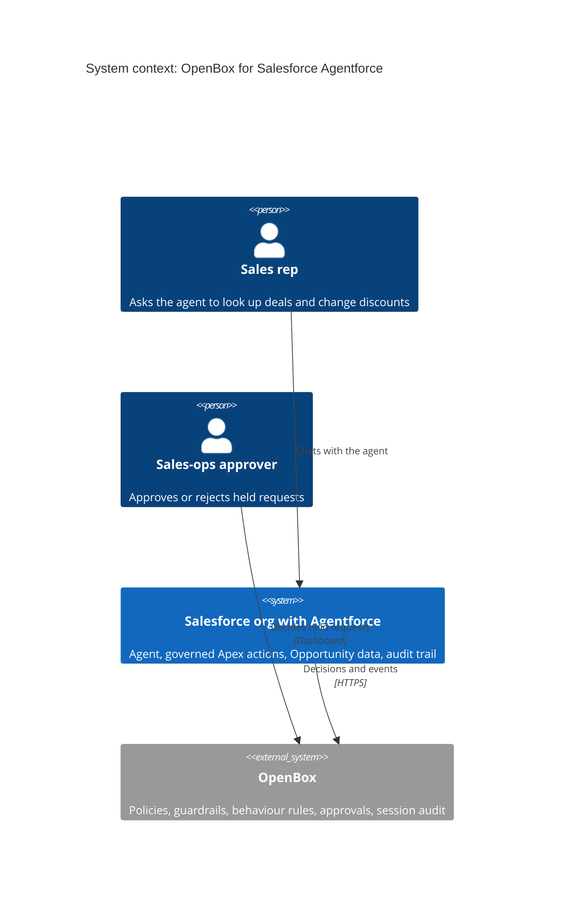
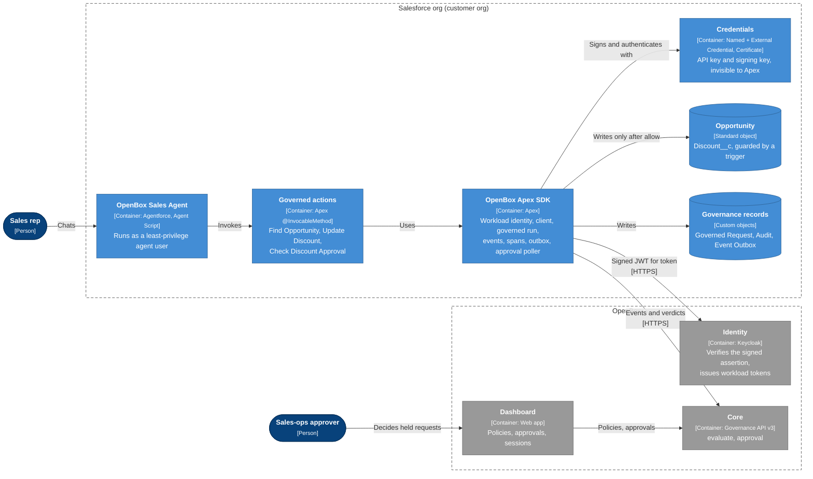
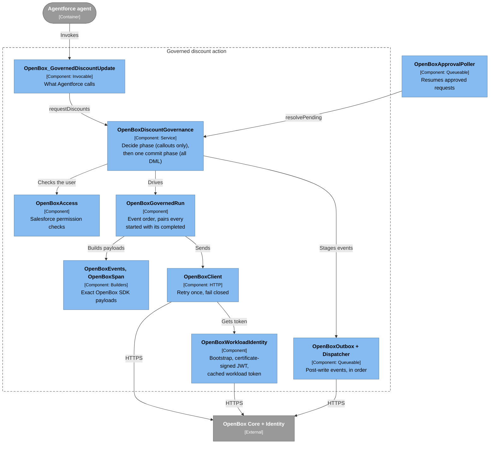
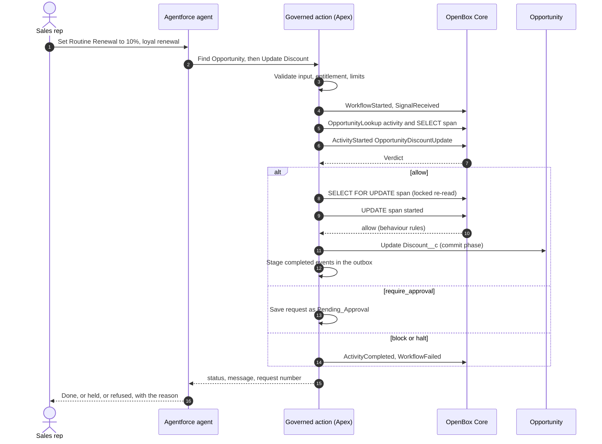
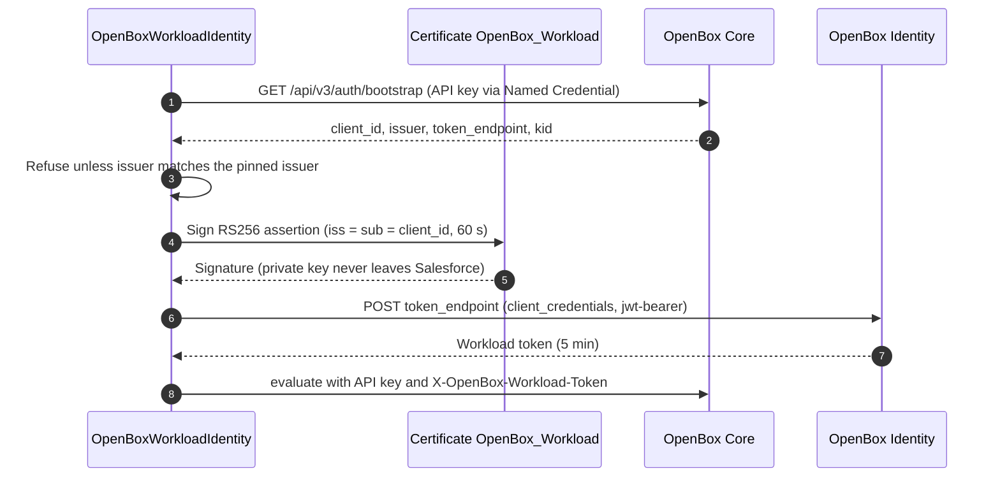
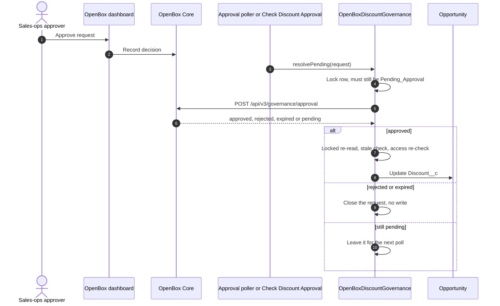
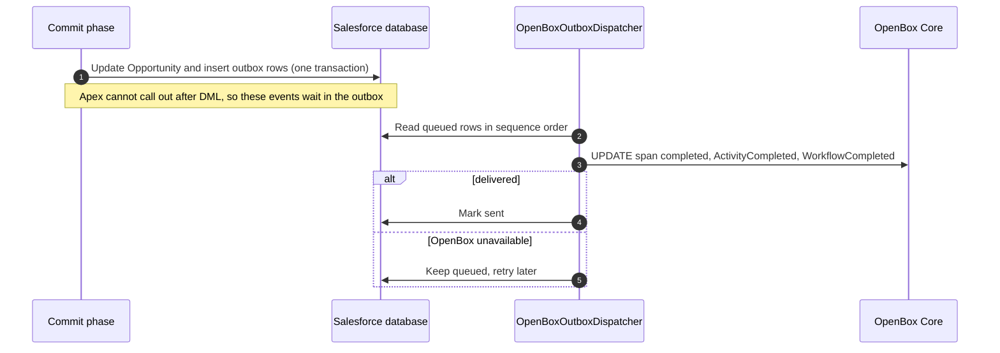

<div align="center">

# OpenBox for Salesforce Agentforce

**Runtime governance for Agentforce agents. OpenBox decides every risky action before Salesforce applies it.**


</div>

---

The OpenBox SDK for Salesforce, written in Apex and installed in the customer's own org. An Agentforce
agent changes Opportunity discounts only through a native Apex action that asks OpenBox first.
OpenBox answers **`allow`**, **`require_approval`**, **`block`** or **`halt`**; Salesforce enforces the
answer before any record changes, and both sides keep a correlated audit of what happened.

> [!NOTE]
> There is no server to host. Salesforce calls OpenBox directly over HTTPS, and OpenBox never calls
> into Salesforce.

## Contents

- [Highlights](#highlights)
- [Architecture (C4)](#architecture-c4)
- [How it works (sequence diagrams)](#how-it-works-sequence-diagrams)
- [Wire format](#wire-format)
- [Security model](#security-model)
- [Policy](#policy)
- [Repository layout](#repository-layout)
- [Getting started](#getting-started)
- [Packaging](#packaging)
- [Operating it](#operating-it)
- [Testing](#testing)
- [Documentation](#documentation)

## Highlights

| | |
|---|---|
| **One path to the data** | The agent cannot edit `Discount__c`; a trigger rejects every change that does not come through the governed action |
| **Four verdicts, enforced** | Allow, require approval, block, halt, enforced in Apex before any write |
| **Fails closed** | No answer, a timeout, a malformed body or an identity failure means no write |
| **No secrets in code** | API key in a Named Credential Apex cannot read; identity proven by a certificate whose private key cannot leave Salesforce |
| **SDK-compatible telemetry** | Events and spans in the same shape as the OpenBox Python and TypeScript SDKs, every *started* paired with its *completed* |
| **Policy without deploys** | Rules, guardrails and behaviour rules are edited in the OpenBox dashboard; the next request follows them |
| **Installable** | Ships as a Salesforce package; tested from a clean install in a fresh Developer org |

## Architecture (C4)

### Level 1: System context



### Level 2: Containers

<sub>C4 notation: blue = container in the org, grey = external system, dashed = boundary.</sub>



### Level 3: Components of the governed action

<sub>C4 notation: light blue = component, grey = outside the container.</sub>



## How it works (sequence diagrams)

### A discount request, end to end



### Workload identity



### Approval



### Events after the write (outbox)



## Wire format

One discount request is one OpenBox run. Events and spans follow the OpenBox SDK wire format (the
LangGraph SDK's lifecycle shapes, the base SDK's flat `SpanData` spans):

```
WorkflowStarted                       goal = the user's request
SignalReceived      user_prompt
ActivityStarted     OpportunityLookup
  span SELECT Opportunity             started → completed
ActivityCompleted   OpportunityLookup output guardrails may redact what the agent sees
ActivityStarted     OpportunityDiscountUpdate   ◄ policy rules and input guardrails decide
  span SELECT Opportunity (FOR UPDATE) started → completed    locked re-read
  span UPDATE Opportunity             started ◄ behaviour rules decide → write → completed
ActivityCompleted   OpportunityDiscountUpdate
WorkflowCompleted | WorkflowFailed
```

- Every `ActivityStarted` is closed by exactly one `ActivityCompleted` with the same `activity_id`,
  on success, failure or refusal. A span refused at `started` is closed as an error. After a `halt`,
  OpenBox closes the session and accepts nothing more.
- Event timestamps are strictly increasing within a transaction, so stored order matches send order.

## Security model

- **The governed action is the only path.** The agent user holds `Discount__c` read-only, and
  `OpportunityDiscountGuard` rejects any discount change not authorized by the governed action
  (people can be exempted with `OpenBox_Discount_Direct_Edit`). Agent instructions are not relied on.
- **Both systems must agree.** An OpenBox `allow` is followed by Salesforce checks for the
  requesting user: entitlement, object edit, field read, record edit access.
- **Fails closed.** Unreachable OpenBox, timeouts, non-2xx answers, malformed bodies, unknown
  verdicts and identity failures all mean no write. Gateway errors are retried once with the same
  idempotency key.
- **Secrets.** The API key lives in the External Credential, encrypted and injected at callout time.
  The signing key never leaves the Salesforce certificate store. Neither is logged or stored in source.
- **Replay safety.** A request executes only from `Pending_Approval`, under `FOR UPDATE`, and leaves
  that status in the same transaction: at most one committed change per request.
- **Staleness.** If the Opportunity changed while the request waited, it is refused as `Stale`.

## Policy

`scripts/openbox/provision.mjs` creates the agent's controls once. After that they belong to the
OpenBox dashboard and are never overwritten (`--reset-policy` restores the defaults). The highest
matching priority wins; a request matching no rule is allowed.

| Priority | Rule, on `ActivityStarted` of `OpportunityDiscountUpdate` | Decision |
|---:|---|---|
| 100 | `is_closed = true` | 🚫 Block |
| 90 | `proposed_discount ≥ 90` | ⛔ Halt |
| 80 | `proposed_discount > 40` | 🚫 Block |
| 70 | `proposed_discount > 15` | ⏳ Require approval |
| — | no rule matches | ✅ Allow |

Also provisioned: **guardrails** (personal data redaction in the justification and the record
snapshot, a manipulation-phrase tripwire), **behaviour rules** (locked re-read before the write,
sign-off for late-stage deals) and **goal alignment**.

## Repository layout

```
.
├── force-app/                     # the package (OpenBoxGovernance, unlocked)
│   └── main/default/
│       ├── classes/               # Apex SDK, governed actions, tests
│       ├── triggers/              # OpportunityDiscountGuard
│       ├── objects/               # Discount__c, Governed Request, Audit, Event Outbox, Settings (mdt)
│       ├── namedCredentials/      # OpenBox_Core
│       ├── externalCredentials/   # OpenBox_Core_Auth (API key)
│       ├── remoteSiteSettings/    # OpenBox_Identity
│       ├── permissionsets/        # OpenBox_Governed_Agent, OpenBox_Governance_Admin
│       └── customPermissions/     # Governed_Discount_Update, Discount_Direct_Edit
├── reference-agent/               # OpenBox_Sales_Agent (Agent Script); deployed, not packaged
├── config/                        # scratch org definition for the package test org
├── scripts/
│   ├── openbox/                   # provision agent and controls, inspect sessions, approvals
│   ├── salesforce/                # certificate, deploy, endpoints, credential, agent user, org setup
│   └── e2e/run-live.mjs           # end-to-end suite against a real org and OpenBox
└── docs/                          # PRD, architecture page, one-pager
```

## Getting started

**Prerequisites:** Node 20+, Salesforce CLI (`npm install -g @salesforce/cli`), an org with Agentforce
enabled, and an OpenBox organisation API key. Every setting is described in [`.env.example`](.env.example).

```bash
# 1. Credentials (never committed)
echo "OPENBOX_ORG_API_KEY=obx_key_..." > .env
sf org login web --alias openbox-dev

# 2. Salesforce certificate; its public key goes to .env for step 3
node scripts/salesforce/workload-certificate.mjs --target-org openbox-dev

# 3. OpenBox: register the agent with that key, attach policy, guardrails, behaviour rules
node scripts/openbox/provision.mjs

# 4. Salesforce: deploy with tests, then credentials, demo data and the poller schedule
node scripts/salesforce/deploy.mjs --target-org openbox-dev
node scripts/salesforce/setup-org.mjs --target-org openbox-dev --skip-deploy

# 5. Agentforce: create the agent user, publish and activate the reference agent
node scripts/salesforce/create-agent-user.mjs --target-org openbox-dev
sf agent publish authoring-bundle --api-name OpenBox_Sales_Agent --target-org openbox-dev --skip-retrieve
sf agent activate --api-name OpenBox_Sales_Agent --target-org openbox-dev
```

> [!IMPORTANT]
> Set `default_agent_user` in `reference-agent/.../OpenBox_Sales_Agent.agent` to the username printed
> by `create-agent-user.mjs` before publishing.

<details>
<summary><b>Other OpenBox environments (staging)</b></summary>

Source points at live OpenBox. Set `OPENBOX_PLATFORM_API_URL` and `OPENBOX_CORE_URL` in `.env`;
`deploy.mjs` then runs `configure-endpoints.mjs`, which asks that Core for its identity issuer and
repoints the Named Credential, the remote site and the pinned issuer in the org only.
</details>

<details>
<summary><b>A second org</b></summary>

Keep its OpenBox agent and key in a separate env file:

```bash
OPENBOX_ENV_FILE=.env.pkg-test OPENBOX_AGENT_NAME="Agentforce Sales Agent (Package Test)" \
  node scripts/openbox/provision.mjs
```

Use the same `OPENBOX_ENV_FILE` for the Salesforce scripts.
</details>

<details>
<summary><b>Settings</b></summary>

The `OpenBox_Settings__mdt` record `Default` holds the Named Credential, agent name, workflow type,
task queue, callout timeout, approval poll interval, per-transaction request limit, outbox retry
attempts, identity issuer and workload certificate name.
</details>

## Packaging

`force-app` is the unlocked package **OpenBoxGovernance**; the Dev Hub is `openbox-dev`.

```bash
# Build a version (runs the Apex tests and the coverage check)
sf package version create --package OpenBoxGovernance --installation-key-bypass --code-coverage \
  --wait 60 --target-dev-hub openbox-dev

# Install into a clean org, as a customer would
sf org create scratch --definition-file config/package-test-scratch-def.json \
  --alias openbox-pkg-test --duration-days 30
sf package install --package <04t version id> --target-org openbox-pkg-test --wait 30 --no-prompt
```

After install, the customer creates the certificate, registers its public key on their OpenBox
agent, stores the agent API key in `OpenBox_Core_Auth`, checks the endpoints, assigns the
permission sets and adds the three actions to their agent. A scratch org needs Einstein and
Agentforce turned on once in Setup, because Salesforce requires a person to accept the terms.

| Version | Subscriber package version | Status |
|---|---|---|
| 1.0.0 | `04tgK000000RkgHQAS` | Installed in a fresh Developer scratch org, verified through the agent chat against OpenBox staging |

> [!TIP]
> An AgentExchange listing needs a managed package under an OpenBox namespace and the Salesforce
> security review.

## Operating it

| Task | How |
|---|---|
| See every governed request | List view or report on `OpenBox_Governed_Request__c` |
| Audit trail | `OpenBox_Governance_Audit__c`, linked to each request |
| Approve or reject | OpenBox dashboard, or `node scripts/openbox/approvals.mjs approve <request-id>` |
| Inspect what OpenBox stored | `node scripts/openbox/inspect-session.mjs <request-id>` |
| Undelivered events | `OpenBox_Event_Outbox__c` with `Status__c` `Queued` or `Failed` |
| Change policy | OpenBox dashboard → the agent → Policy |
| Redeploy | `node scripts/salesforce/deploy.mjs` (pauses and restores the poller schedule) |

## Testing

| Suite | Command | Covers |
|---|---|---|
| Apex | run by `deploy.mjs` and every package version build | Every PRD acceptance criterion against a scripted OpenBox: workload identity, event and span pairing, trust boundary, fail closed, approvals, replay, staleness |
| End to end | `node scripts/e2e/run-live.mjs --target-org openbox-dev` | The deployed action against the OpenBox environment in `.env`; checks the Salesforce outcome, the verdicts OpenBox recorded and the stored session's pairing. Report in `out/e2e-report.json` |

## Documentation

- [`docs/OpenBox-Salesforce-One-Pager.txt`](docs/OpenBox-Salesforce-One-Pager.txt) and [`.docx`](docs/OpenBox-Salesforce-One-Pager.docx): customer one-pager
- [`docs/OpenBox-Salesforce-Architecture.html`](docs/OpenBox-Salesforce-Architecture.html): architecture page
- [`docs/PRD.md`](docs/PRD.md): the original requirements, with as-built implementation notes
